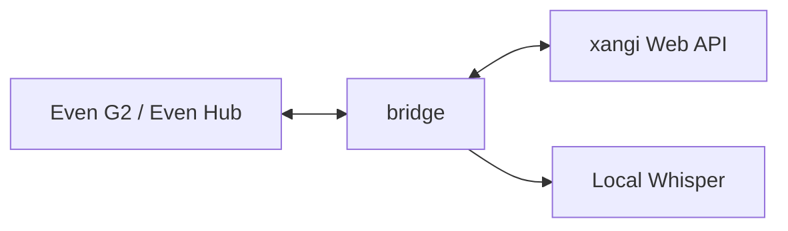

# xangi for G2

[日本語](README.md) | English

Read [xangi](https://github.com/karaage0703/xangi) conversations and speak to your assistant through an Even Hub app for Even Realities G2.

## Features

- Read Web, Discord, and Slack conversation history on the glasses
- Transcribe speech, review it, and send it to Web or Discord conversations
- View responses and reply suggestions to continue the conversation
- Connect to your own xangi through Tailscale and transcribe with local Whisper

## Architecture

The bridge and speech service can run as a xangi Managed Extension. See the [design guide](docs/design.en.md).

## Get Started

You need Even G2, an iPhone with Even Hub, and a machine running xangi. Connect the iPhone and machine to the same Tailscale network.

1. Start the bridge and speech service using the [Extension setup](XANGI_SETUP.en.md).
2. Build and install the Even Hub app using the [setup guide](docs/setup.en.md).
3. Save the Bridge URL and Token in the iPhone companion screen, then open a conversation on G2.

See [usage](docs/usage.en.md) for controls and the [setup guide](docs/setup.en.md) for manual installation and troubleshooting.

## Documentation

- [Usage and development commands](docs/usage.en.md)
- [Design and data flow](docs/design.en.md)
- [Setup and troubleshooting](docs/setup.en.md)
- [Managed Extension operation](XANGI_SETUP.en.md)
- [Standalone bridge and STT operation](bridge/README.en.md)
- [AI operation skill](skills/xs-xangi-even-g2/SKILL.md)

## License

[MIT](LICENSE)
