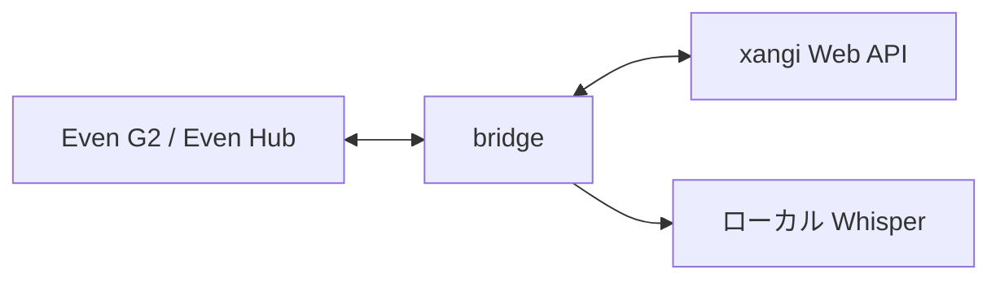

# xangi for G2

日本語 | [English](README.en.md)

Even Realities G2 から [xangi](https://github.com/karaage0703/xangi) の会話を読み、音声で話しかける Even Hub アプリです。

## 主な機能

- Web・Discord・Slack の会話履歴をメガネで読む
- 音声を文字起こしし、確認してから Web・Discord の会話へ送信
- 回答と返信候補を表示し、メガネから会話を続ける
- 自分の xangi に Tailscale 経由で接続し、ローカル Whisper で音声認識

## 構成

bridge と音声認識サーバーは、xangi の Managed Extension として管理できます。詳しくは[設計](docs/design.md)を参照してください。

## 使い始める

Even G2、Even Hub を入れた iPhone、xangi を動かすマシンを用意します。iPhone とマシンを同じ Tailscale ネットワークに接続してください。

1. [Extension セットアップ](XANGI_SETUP.md)に従い、bridge と音声認識を起動します。
2. [セットアップガイド](docs/setup.md)に従い、Even Hub アプリをビルド・インストールします。
3. iPhone の companion 画面で Bridge URL と Token を保存し、G2 から会話を開きます。

操作方法は[使い方](docs/usage.md)、手動起動や接続トラブルは[セットアップガイド](docs/setup.md)を参照してください。

## ドキュメント

- [使い方・開発コマンド](docs/usage.md)
- [設計・データフロー](docs/design.md)
- [セットアップ・トラブルシュート](docs/setup.md)
- [Managed Extension の運用](XANGI_SETUP.md)
- [bridge・STT の単体運用](bridge/README.md)
- [AI向け操作スキル](skills/xs-xangi-even-g2/SKILL.md)

## ライセンス

[MIT](LICENSE)
