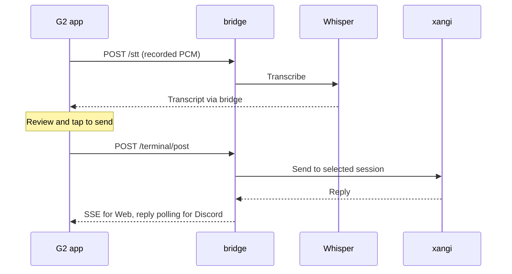

# Design

[日本語](design.md) | [README](../README.en.md) | [Usage](usage.en.md)

## Components

- `src/main.ts`: G2 screens, gestures, recording, session selection, and reply display.
- `src/bridge.ts`: HTTP requests and connection settings.
- `src/reply-completion.ts`: Displays completed Discord replies before reconciling history.
- `bridge/even_g2_bridge.py`: Proxies transcription and xangi API requests. xangi owns inference and conversation history.
- `bridge/stt_server.py`: Local Whisper transcription.
- `bridge/extension_runtime.py`: Managed Extension lifecycle and health for the bridge and STT.

## Speech to Reply

Recording stops before sending. Reply display does not wait for another microphone stop acknowledgement.

## Sessions and Display

`New Session` is a local draft. The first send creates a Web session; subsequent sends reuse its ID. Discarding a transcription or leaving before sending does not save the draft. Creation and submission use separate APIs, so retries reuse the created ID if the first submission fails.

- Web: Sends to `/api/terminal/inbox` and receives `/api/events/stream` events through the bridge. Events from a previous session do not update the screen.
- Discord: Continues the original conversation through `/api/sessions/:id/discord-continue`. The bridge creates an asynchronous job; G2 polls `/terminal/reply` every three seconds. The conversation view returns after send acceptance.
- Slack and other platforms: History can be viewed, but sending through this bridge is unsupported.

Completed Discord reply text is displayed before history reconciliation. A failed history request does not remove the reply, and completion does not overwrite another session's screen. Reply jobs live in bridge memory and are lost on restart.

History is fetched in batches of 30 messages and paginated for the G2 display. Suggestions for the latest reply appear as additional pages after its text.

## Connections and Settings

For a Managed Extension, set Bridge URL to `http://<xangi-host>:<xangi-port>/api/devices/xangi-even-g2`. The xangi host must support this ingress. Keep the dedicated `EVEN_BRIDGE_TOKEN` (`DEVICE_BRIDGE_TOKEN` is also accepted). Bridge and STT bind automatically allocated loopback ports; configured HOST/PORT values apply only to standalone operation. Do not enter internal ports in the companion.

The host forwards the device token separately from the runtime token; the extension validates it. Audio POST and SSE use the same ingress. STT is not exposed externally.

This uses the generic device ingress selected by the manifest `deviceIngress`, rather than a product-specific host route. This extension declares `capability: device.even-g2` and `authentication: extension-bearer`.

Connection settings are saved and loaded through companion localStorage and Even storage. Build-time defaults apply when saved values are absent. Normal builds do not embed tokens. Configured private builds contain secrets and must not be published.

See [Extension operation](../XANGI_SETUP.en.md) and [setup](setup.en.md) for configuration, networking, and standalone operation.

### Initialization group

The manifest declares startup.exclusiveGroup=gpu and timeoutSeconds=120. Health startup.state is initializing while the STT model loads, complete after loading or when STT is disabled, and failed if the STT child exits before completion. Bridge/device connectivity does not hold this group once GPU initialization finishes. Older hosts ignore these additional fields.
