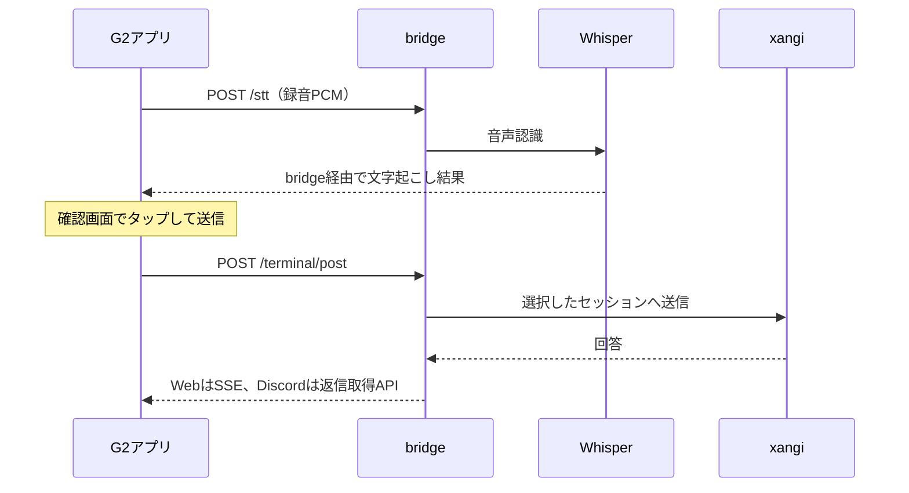

# 設計

[English](design.en.md) | [README](../README.md) | [使い方](usage.md)

## コンポーネント

- `src/main.ts`: G2の画面、ジェスチャー、録音、セッション選択と回答表示。
- `src/bridge.ts`: bridgeへのHTTP通信と接続設定の保存。
- `src/reply-completion.ts`: Discordの取得済み回答を先に表示し、履歴を後から照合。
- `bridge/even_g2_bridge.py`: 音声認識とxangi APIへの中継。推論や会話履歴の管理はxangiが担当。
- `bridge/stt_server.py`: ローカルWhisperによる文字起こし。
- `bridge/extension_runtime.py`: Managed ExtensionとしてbridgeとSTTの起動・停止・状態確認を提供。

## 音声から回答まで

録音停止は送信前の処理で行い、回答表示時は再度マイク停止の完了を待ちません。

## セッションと表示

`New Session`はアプリ内の下書きです。最初の送信時にWebセッションを作成し、以降は同じIDを使います。文字起こしの破棄や送信前の画面移動では保存しません。作成と送信は別APIなので、初回送信が失敗した場合は作成済みIDを再試行で使います。

- Web: `/api/terminal/inbox`へ送信し、`/api/events/stream`のイベントをbridge経由で受信します。移動前のセッションのイベントは表示へ反映しません。
- Discord: `/api/sessions/:id/discord-continue`で元の会話を継続します。bridgeが非同期ジョブを作り、G2は`/terminal/reply`を3秒ごとに確認します。送信受付後は会話画面へ戻ります。
- Slackなど: 履歴閲覧に対応し、このbridgeからの送信は未対応です。

Discordの完了本文は履歴APIの再取得より先に表示します。履歴同期に失敗しても回答を維持し、別セッションへ移動していれば画面を上書きしません。返信ジョブはbridgeのメモリ内にあり、再起動で失われます。

履歴は30件ずつ取得し、本文をG2の表示領域に合わせて分割します。最新の回答に候補がある場合は、本文の後ろへ候補ページを追加します。

## 接続と設定

G2アプリはTailnet向けbridge listenerへ直接接続します。Managed Extensionの管理用HTTP endpointとは別です。Managed runtimeは親xangiのWeb URLを受け取り、単体起動では`XANGI_BASE_URL`を使います。

接続設定はcompanionのlocalStorageとEven側ストレージを通して保存・読込します。保存設定がなければビルド時の初期値を参照します。通常のビルドにはtokenを埋め込みません。設定入りのprivate buildは秘密情報を含むため公開しないでください。

設定・起動手順は[Extension運用](../XANGI_SETUP.md)、ネットワークと単体起動は[セットアップ](setup.md)を参照してください。
